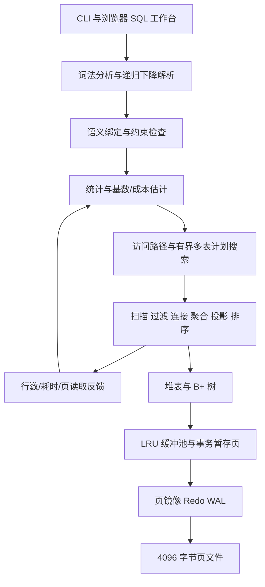

# AuroraDB 自研关系数据库 v1.2.0

对应数据库原理大作业 **方案 1**。这是一个可以检查内部机制的教学数据库，SQL 解析、关系执行、磁盘存储、LRU 缓冲、B+ 树和事务恢复均在项目源码中实现。运行时只使用 Python 标准库；SQLite 只作为测试中的独立结果对照。

## 直接运行

Windows 64 位环境双击 **启动工作台.cmd**，即可打开本机 SQL 工作台。无需安装 Python 或数据库。服务运行时保持命令行窗口开启；按 Ctrl+C 关闭。默认地址为 `http://127.0.0.1:8765`。

`--demo` 只在没有表的数据库中创建示例，不覆盖已有数据。示例包含学生、课程和选课记录，可使用界面里的八组预设 SQL。多个浏览器标签共享同一个事务会话。

PPT 中的 CS 学生选课用例位于 **辅助工具 → 研究实验 → 自适应优化 → PPT 用例**，默认折叠。点击“运行用例对比”后，在独立临时库创建 1,000 名学生（CS 10 人）、10,000 条选课和 100 门课程，采集统计、训练模型，再交替实测两种策略各 3 次并显示耗时中位数、连接比较次数、完整结果核对及执行计划。当前数据库、事务和编辑器不受影响，演示结束后清理临时库；耗时为本机实时测量，不复用 PPT 的历史数字。

```powershell
.\dist\AuroraDB.exe --demo --web --db .\data\demo
.\dist\AuroraDB.exe --db .\data\demo --execute "SHOW TABLES;"
.\dist\AuroraDB.exe --db .\data\demo
.\dist\AuroraDB.exe --demo --web --port 8766 --db .\data\another-demo
```

同一个数据库目录同时只能由一个连接打开。工作台占用数据库时，另一个命令行实例需要使用不同目录，或先退出工作台。

### macOS系统

Mac 使用 Python 3.12+ 的源码入口，无需安装第三方运行库。在仓库根目录执行：

```bash
bash ./启动工作台.command
```

脚本优先使用项目 `.venv`，自动检查 Python 版本、切换到项目目录、选择空闲端口并打开浏览器，数据存放在 `data/mac-demo`。支持 Apple Silicon 与 Intel 的对应 Python 环境，不使用 Windows EXE。PPT 用例入口与 Windows 相同。

正式演示前运行 `python3 tools/check_macos.py`（使用虚拟环境时改用其 Python），检查资源加载、文件锁、中文/空格路径、PPT 接口及结果一致性。报告保存在 `.build/macos-compatibility.json`，只有在真实 macOS 上运行成功才标记 `native_macos_verified: true`；浏览器排版另在目标 Mac 上检查。更多交接说明见 `MAC_Codex_交付交接.md`。

## 开放数据集模式：Chinook

项目保留中文 `students / courses / enrollments` 作为默认教学数据，同时提供可重复导入的 Chinook 公开数据集模式。Chinook 是一个可跨数据库使用的音乐商店示例数据集，官方上游仓库提供 SQLite、MySQL、PostgreSQL、SQL Server、Oracle 和 DB2 版本；DemoDB 的公开统计包含 11 张表、约 1.56 万行（其中 `Track` 3,503、`PlaylistTrack` 8,715、`InvoiceLine` 2,240），适合展示多表连接、分组聚合、排序、索引和真实数据分布。

```powershell
# 导入并核验独立的 Chinook 数据目录（不会覆盖中文教学库）
python tools/import_chinook.py --db data/chinook
# 也可由启动参数自动初始化
python -m auroradb --dataset chinook --web --port 0 --db data/chinook
# 或使用打包程序
dist\AuroraDB.exe --dataset chinook --web --port 0 --db data\chinook
```

导入器把公开脚本映射到 AuroraDB 当前支持的 `INTEGER / REAL / TEXT / BOOLEAN` 类型，并跳过视图、触发器、存储过程和二进制媒体列；原始字段映射、行数校验和来源写入 `docs/chinook_import.json`。这样既保留数据集的关系结构，又明确区分“可运行子集”和完整上游数据库功能。Chinook 源码与数据按其上游 MIT 许可使用，来源为 [官方仓库](https://github.com/lerocha/chinook-database) 和 [公开表规模页](https://chinook.demodb.dev/downloads/)。

答辩时建议保留两条演示线：中文库讲清需求、事务、NULL 和 AI 语义筛选；Chinook 库讲清 `Artist → Album → Track → Genre` 和 `Invoice → InvoiceLine → Track` 的连接与聚合；5000/6000 行固定实验仍用于性能结论。不要把 Chinook 的静态行数当成优化收益证明，也不要把未导入的视图、触发器和 BLOB 能力写成已实现功能。

## 从源码运行

需要 Python 3.12 或以上，无运行依赖安装步骤。在本目录执行：

```powershell
python -m auroradb --demo --web
python -m auroradb --db data/example --file auroradb/examples/demo.sql
python -m auroradb --db data/example --execute "SELECT * FROM students ORDER BY id;"
python tools/verify.py
python tools/benchmark.py
```

命令行 REPL 支持跨行 SQL、`.help`、`.tables`、`.stats` 和 `.quit`。批处理错误返回非零退出码。工作台支持 Ctrl+Enter 执行当前选区或全文，展示结果、物理计划和真实页 I/O 计数。

## 附加功能与 AI

工作台使用黑白配色，直接显示编辑器、查询结果、物理计划和实际统计。顶部显示自动提交或活动事务，以及暂存页数。

- **一致性检查**：界面按钮或 `CHECK DATABASE;` 检查物理页 CRC、目录、堆记录、约束、B+ 树和索引与堆表的对应关系。只读检查当前会话的数据；物理读取绕过已提交页缓存。保留但未回收的历史页单独报告，不作为错误。此功能不验证 WAL 协议，不自动修复文件。
- **扫描对比**：对同一条 SELECT 分别使用全表扫描和规划器自动选择，展示实际扫描行数、页读取和时间，并按保留重复项及输出类型的结果集合核对一致性。每路前清空应用缓冲池；操作系统缓存和事务暂存页保留。对比使用不带 LIMIT / OFFSET 的单个 SELECT，避免排序同值项导致不同合法子集；结果对比不验证输出顺序。
- **AI 助手**：生成 SQL、解释当前 SQL、提出优化建议。发送问题、SQL、表结构和编译计划，不自动发送结果行或列默认值；你输入问题或 SQL 中的字面量仍会发送。建议在本地通过语法、名称绑定和计划校验后可填入编辑器，执行由用户点击。校验不执行查询，也不保证模型语义与用户意图一致。

没有本地 AI 配置时，AI 默认关闭，数据库功能可独立使用。`启动工作台.cmd` 检测到 `ai.local.json` 后会自动加载学校 AI，也可双击 `启动学校AI.cmd` 明确使用该配置。双击 `启动AI演示.cmd` 使用明确标记的**本地规则演示**，用于验证交互，没有调用远程模型。学校 API 已接入本机私有配置，并通过首次真实请求；需处于校园网，校外先连接学校 VPN。组员首次配置时，将 `ai.example.json` 复制为 `ai.local.json`，填入自己获准使用的 API Key。

```json
{
  "mode": "remote",
  "base_url": "https://models.sjtu.edu.cn/api/v1",
  "model": "deepseek-chat",
  "api_key": "",
  "timeout": 180,
  "requests_per_minute": 10
}
```

学校端点为 `/api/v1/chat/completions`，使用 Bearer 鉴权。默认选 `deepseek-chat`；可切换为 `deepseek-reasoner`、`qwen` 或 `qwen3.8-27b`。地址与调用名已按[学校官方文档](https://claw.sjtu.edu.cn/guide/sjtu-api/)核对。AI 配置仅在后端读取，不进入浏览器，`*.local.json`、环境变量文件和含非空顶层 `api_key` 的有效配置 JSON 会从提交包排除。也可通过 `--ai-config` 指定配置文件，或使用 `AURORA_AI_MODE`、`AURORA_AI_BASE_URL`、`AURORA_AI_MODEL`、`AURORA_AI_API_KEY`、`AURORA_AI_TIMEOUT`、`AURORA_AI_REQUESTS_PER_MINUTE` 环境变量。

学校额度为每分钟 10 次请求、300000 tokens，每周 1000000000 tokens。项目的每分钟请求限制由当前进程内的 AI 服务共享；同一 Key 的其他进程、设备或应用仍会共同占用学校额度，不能由本机限流全局协调。远程配置状态不代表连接成功，具体实连结果见 `docs/campus_api_smoke.json`；少量成功请求不代表模型准确率或优化收益。网络请求不持有数据库锁，失败不会关闭 SQL 工作台。详细步骤见 `docs/AI_API接入说明.txt`。

`timeout` 通用代码默认 90 秒、允许 0.1–300 秒；学校模板及本机配置为 180 秒。本轮实连曾发生一次 90 秒内未取得解释响应的情况，原记录保留在 `docs/campus_api_timeout_observation.json`。该值是一次远程请求的网络总期限，覆盖传输槽等待、DNS、连接/TLS、写入及读取。AI 状态公开 `timeout_seconds`，AI 助手与可信优化页面按该值再加 15 秒等待，最大 315 秒。每个 AIService 最多同时保留两个传输任务；系统 DNS 调用不能强制中断，超时后其任务仍占槽直到结束，结束后不会补发已取消的请求。延长等待不能保证网络或模型排队始终可用，演示时应准备普通 SQL 路径。

工作台接口拒绝重复 JSON 字段、NaN/Infinity、数值溢出、孤立 Unicode 代理字符、过深嵌套及路由未知参数；非法请求返回 400，不执行其中的 SQL。模型输出也检查完整协议、最终助手角色与有效 Unicode；语义标签在 JSON 解码后再次检查受保护凭证，拒绝后不写入推理缓存。

## 四项研究扩展

工作台“辅助工具 → 研究实验”提供以下功能；默认启发式优化与 LRU，普通 SQL 独立于模型。完整引用及实测结果见 `docs/AuroraDB_大作业报告.pdf`，实现契约见 `docs/RESEARCH_DESIGN.txt`。

| 方向 | 已实现的创新点 | 研究依据 |
| --- | --- | --- |
| 可信查询优化 | OR 等值合并为 IN、重复 AND 消除、WHERE TRUE 消除的规则证据；编译和完整结果核对；3 次实测及保守推荐；同版本结论复用、规则模板登记 | [QO-Verify，CIDR 2026](https://www.cidrdb.org/cidr2026/papers/p33-narasayya.pdf)、[ReSequel，PVLDB 2026](https://arxiv.org/abs/2606.20853) |
| 统计与轻量学习 | 行数/NULL/NDV/12 桶直方图；过滤与连接反馈校准；扫描和索引的 ridge 读路径成本学习；有界多表 INNER JOIN 动态规划搜索；训练域外回退 | [PRICE，VLDB 2025](https://github.com/StCarmen/PRICE)、[CardOOD，VLDB Journal 2026](https://link.springer.com/article/10.1007/s00778-026-00979-3) |
| 预测缓冲 | 可切换的串行扫描感知、近期热点保护、有限候选采样；无证据时 LRU 回退；容量与采样/历史/开销计数 | [Sampling-based Predictive Database Buffer Management，PVLDB 2025](https://www.vldb.org/pvldb/vol18/p5569-khalaji.pdf) |
| 语义执行算子 | 显式筛选、逐行分类、标签聚合；推理批处理、同次去重、精确 TTL 缓存、严格 ID 响应校验和预算 | [iPDB，2026 预印本](https://arxiv.org/abs/2601.16432) |

可信改写中的 `proven` 只适用于本项目支持的规则和前置条件；`tested` 只表示当前提交数据上结果一致，未知模型候选不会自动推荐替换。相同 SQL、数据代次、优化模式、模型版本和缓冲策略可命中已验证结论，明确标记未重测；查询模板登记形状和规则元信息，当前不跳过候选构造。写入、事务状态、统计更新与缓存策略变化使相关结论失效。

语义实验默认 64 行、每批 8 条、最多 8 批、总预算 30 秒；SQL 执行协作式检查 6 秒、10 万扫描行、20 万连接比较和 2 万中间行。规划计入总时长但不能强制中断，预算不是硬实时保证。只把用户选择的 TEXT 字段与判断条件发送给模型。NULL 不调用模型；推理期间释放数据库锁，输出对应开始时的提交态物化快照。本地规则模式只接受 `关键词：数据库|查询|索引` 这类条件。

这些是研究思想在教学内核上的缩减实现，不是原论文完整系统的复现。缓存 180 次实验结果全部一致，部分热点配置减少约 2.55% 文件页读取，纯扫描存在时间退化；本地语义协议实验将 32 次请求降为批量 4 次、热缓存 0 次。学校真实模型的系统性准确率、延迟分布和优化收益仍需单独实验，不能用协议演示或连通性测试替代。

```powershell
python tools/optimizer_experiment.py
python tools/join_optimizer_experiment.py
python tools/buffer_experiment.py
python tools/semantic_experiment.py
python tools/research_executable_smoke.py
```

## 对应作业要求

| 课程要求 | 实现入口 | 验证依据 |
| --- | --- | --- |
| 存储管理器与高效访问 | `auroradb/storage.py` 的 HeapTable 和 BPlusTree | 磁盘页、索引分裂、范围查询、重启验证 |
| 缓冲管理器 | DiskPager 的有界 LRU 页缓存 | 容量、命中、淘汰与真实读写计数测试 |
| SQL 编译与查询优化 | `auroradb/sql.py` 和 `auroradb/engine.py` | 词法与语法分析、名称绑定、索引选择、谓词下推、哈希连接 |
| 执行引擎 | Database 的关系执行流程 | CRUD、连接、聚合、排序、NULL 语义及差分测试 |
| 用户界面 | `auroradb/web/`、server.py、__main__.py | 浏览器工作台和命令行，真实 HTTP 集成测试 |
| 源码与可执行程序 | auroradb、tests、tools、dist/AuroraDB.exe | 可复现构建及打包程序实际运行检查 |
| 大作业报告（唯一的报告文件） | docs/AuroraDB_大作业报告.pdf | 以下各项均包含在这一份报告中 |
| 软件工程规范方法 | 报告第 3、4、11、12 节 | 用例图与用例规约、23 条功能需求与 8 条非功能需求、UML 类图 / 时序图 / 状态图、55 个测试用例、需求追踪矩阵、已知缺陷、迭代与配置管理 |
| 各模块实现方法与测试报告 | 报告第 5–9、11 节；docs 内 JSON 与内部设计说明 | 五个组件与四项创新的实现、279 项测试、实验结果与原始证据 |
| 使用说明 | 报告第 10 节；本 README | 启动方式、命令行与 AI 配置 |
| 小组分工和完成情况 | 报告第 13 节；docs/分工说明填写表.txt | 四人分工、负责模块、源文件与测试 |

## 支持的 SQL

- DDL：CREATE / DROP TABLE，CREATE / DROP INDEX，CREATE UNIQUE INDEX。
- 类型：INTEGER、REAL、TEXT、BOOLEAN；INT、FLOAT、VARCHAR(n)、BOOL 为可用别名。严格检查存储类型，VARCHAR(n) 按字符数限制。
- 约束：单列 PRIMARY KEY、UNIQUE、NOT NULL、常量 DEFAULT。主键和 UNIQUE 使用受保护的索引。
- DML：多行 INSERT、指定列 INSERT、UPDATE、DELETE。
- 查询：SELECT、DISTINCT、WHERE、INNER / LEFT / CROSS JOIN、逗号隐式连接、GROUP BY、HAVING、ORDER BY、LIMIT / OFFSET。
- 表达式：算术、比较、AND / OR / NOT、IN、BETWEEN、IS NULL、LIKE；SQL NULL 三值逻辑。
- 聚合：COUNT、SUM、AVG、MIN、MAX。标量：LOWER、UPPER、LENGTH、ABS、ROUND、COALESCE。
- 事务与诊断：BEGIN、COMMIT、ROLLBACK、CHECKPOINT、CHECK DATABASE、SHOW TABLES、DESCRIBE、EXPLAIN、EXPLAIN ANALYZE。
- 词法：分号脚本、转义引号、双引号或反引号标识符、行注释和嵌套块注释。标识符统一为小写；引号标识符中不允许点号。

不支持的 SQL 会显式报错。本项目不宣称完整 SQL 标准兼容。当前没有外键、复合键、子查询、窗口函数、RIGHT / FULL JOIN、ALTER TABLE、视图、触发器或用户权限系统。

`/` 返回实数，除零返回 NULL；`%` 的结果与被除数同号；LIKE 不区分大小写。ORDER BY 默认升序 NULL 在前、降序 NULL 在后。GROUP BY 严格检查非聚合列；GROUP BY 和 HAVING 使用源列或表达式，ORDER BY 可使用输出别名和列序号。

DISTINCT 与 GROUP BY 使用带 SQL 类型的键，BOOLEAN 不与数值 0/1 合并；INTEGER/REAL 保留数值兼容。JOIN 在选择物理算法前校验已知比较类型，避免哈希连接与嵌套循环对类型不兼容条件产生不同结果；动态类型表达式仍由执行器检查。

连接优化不依赖 `JOIN` 关键字：纯内连接中的逗号写法、`CROSS JOIN + WHERE` 和 `ON` 写法会先规范化，跨表 WHERE 条件进入连接条件，单表条件用于安全过滤。自适应模式对两表、非等值连接及多表搜索回退路径也选择右表访问路径并提前过滤；直接列之间的 `< / <= / > / >=` 条件可使用 `RangeJoin`，排序右输入后通过二分定位候选，再检查完整 ON。等值条件优先使用哈希连接；无法使用这些算法的条件保留嵌套循环。`LEFT JOIN` 只提前处理安全的输入过滤，右表 WHERE 条件仍在连接后检查，不重排外连接。

连接顺序动态规划仍限于 3–6 张表的连通等值内连接和左深计划，非等值连接只优化访问、过滤和执行算法，不进入当前顺序搜索。无连接条件的笛卡尔积可以执行，但不凭空生成连接边；子查询、USING/NATURAL、RIGHT/FULL JOIN 仍不支持。查询结果可能有多种合法顺序，需要确定顺序时应写 ORDER BY。

ROUND 使用十进制半值远离零舍入，例如 `ROUND(2.5)=3`、`ROUND(-2.5)=-3`；精度参数必须是 -308 到 308 的整数，不接受布尔值。

## 架构与执行



索引处理单列等值、范围和 IN 多探测条件，候选 RID 去重。默认规划器读取候选 RID 数量，当候选量不超过总记录数的 35%（至少一条）时选择索引；adaptive 模式可使用已就绪的读路径成本模型，最终仍执行残余谓词。采集统计后，adaptive 对至少三表的受限 INNER JOIN 使用最多六表、512 个候选前缀和 20ms 搜索预算的动态规划；搜索比较访问路径成本与连接输入/输出规模，不执行候选查询。选定顺序后只执行一次所选计划；搜索不可靠、收益不足、超预算或形状不受支持时回退 SQL 顺序。LEFT JOIN 不重排。受支持的计划会下推单表过滤。计划节点保留估计/实际行数和 Q-error，工作负载摘要有界保存且不含字面量或结果行；写入、重新统计和缓冲设置变化会使相关模型失效。

## 事务和恢复

修改在独立暂存页中完成，提交前不写数据文件。提交先写完整页镜像 WAL 和提交摘要并 fsync，再写数据页并 fsync，最后清空日志。重启只重放完整且校验通过的已提交事务。页头和正文包含 CRC 校验，WAL 帧包含 CRC，事务摘要使用 SHA-256。

完整 BEGIN 与全部声明页镜像之后出现完整未知尾帧时，即使提交类型损坏，也保留 WAL 与数据原字节并拒绝恢复。该证据只用于阻止误清理，不能单独授权重做；修复后的完整日志仍须通过全部提交校验。

单条写语句自动提交；显式事务可以读到自己的修改。活动事务中发生 SQL 解析或执行错误会整体回滚。一个脚本内的多个自动提交语句彼此独立；需要脚本原子性时使用 BEGIN 和 COMMIT。关闭连接会回滚未提交事务。

提交发生 I/O 错误时，提交结果可能需要由持久日志判断。连接进入不可继续执行状态，保留 WAL，关闭并重新打开后恢复；不会把已经持久化的提交伪装成可撤销操作。

## 容量和适用范围

这是单机教学内核，连接互斥，执行在一个会话中串行化；没有多会话 MVCC。4096 字节页的有效载荷为 4076 字节，单条记录必须能装入页，索引键编码上限为 1024 字节。事务暂存页独立于 LRU 容量，大事务内存占用可能增长；查询的连接、聚合、排序在内存中完成，没有外部归并。

目录采用根页与分块目录页，避免所有元数据挤在一页；根页清单仍有容量上限。更新变长记录通过转发保留 RID。删除索引项采用惰性处理，保留空叶；DROP 不回收文件页，当前没有 VACUUM。文件损坏会报错并保留证据，不做未经验证的数据修复。

## 验证和可复现构建

`tools/verify.py` 执行 unittest 全套测试并写入 `docs/test_results.json`。包含 180 次固定种子 SQLite SELECT 对照，以及 B+ 树重复键与多层分裂、页损坏、LRU、真实子进程崩溃恢复、HTTP 与命令行测试。

`python tools/audit_queries.py` 另行运行 285 次有无索引结果对照，以及 99 次 SQLite JOIN / GROUP BY / HAVING 对照，将真实执行汇总、种子和覆盖范围写入 `docs/audit_queries.json`。这 384 次查询审计独立于 unittest 中的 180 次 SQLite 对照；BOOLEAN 与数值的隐式转换会被拒绝，并由语义回归测试覆盖。

`tools/benchmark.py` 用 5000 条记录比较相同选择条件建索引前后的冷缓存与重复查询，保存时间、实际扫描记录数和页读取数到 `docs/benchmark.json`。耗时依赖运行环境，不能推广为所有负载的速度保证。

打包仅需要一个构建依赖，运行程序不需要该依赖：

```powershell
python -m pip install --target .build/deps pyinstaller
python tools/build_exe.py
```

源码模块和测试均带注释。大作业报告用 LaTeX（XeLaTeX）编写，报告中的 55 个测试用例在生成时逐条核对其在 `docs/test_results.json` 中存在且已通过。

```powershell
python tools/executable_smoke.py
python tools/research_executable_smoke.py
python tools/package_submission.py
```

完整提交包的 `MANIFEST.json` 保存每个文件的 SHA-256；打包程序会重新读取 ZIP 并验证所有文件内容。

打包排除规则不区分文件名大小写，并排除任意目录下的 `pages.dat`、`redo.wal`、`.db` / `.sqlite` / `.sqlite3` 数据文件及对应 SQLite WAL/SHM 文件；本地配置和环境变量文件仍按前述规则排除。

架构背景参考 [SQLite Architecture](https://www.sqlite.org/arch.html)、[SQLite Atomic Commit](https://www.sqlite.org/atomiccommit.html) 和 [PostgreSQL EXPLAIN](https://www.postgresql.org/docs/current/using-explain.html)。实现采用项目自己的页格式、执行器和日志协议，并不兼容上述系统的数据文件。
